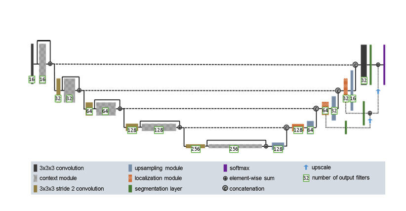
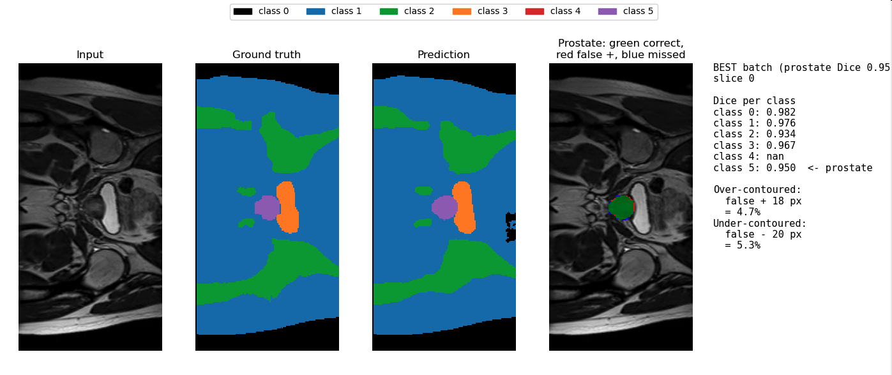
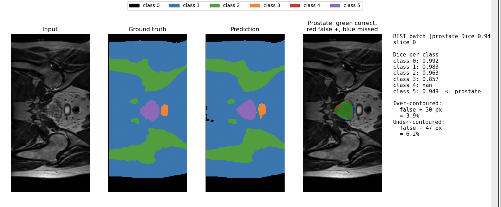
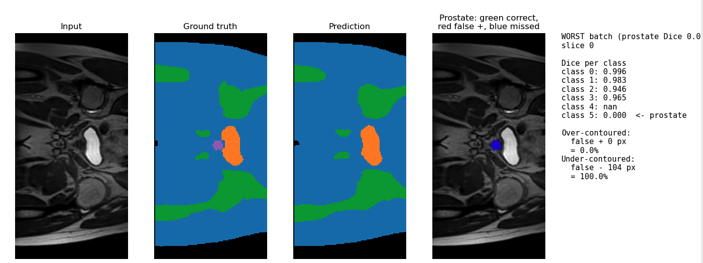
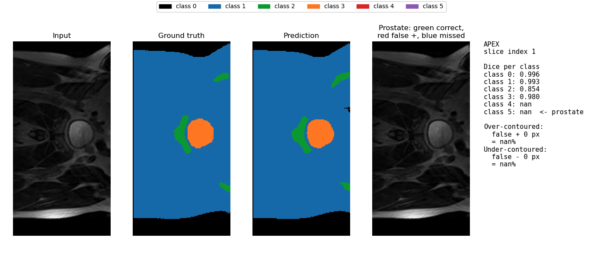
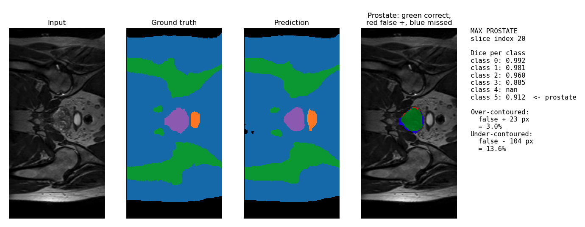
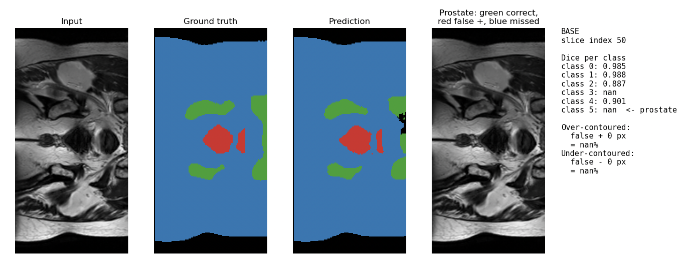

# 2D Improved U-Net Research - Segmentation Anatomical Contouring and Radiotherapy Planning  

**Name:** Alyx Goller  
**Student ID:** 4695049  

**Open-Ended Project and Difficulty**  
2.2 Segmentation: Anatomical Contouring and Radiotherapy Planning  
2D Improved U-Net (Normal Difficulty)  


## Introduction  

### Algorithm and the problem it solves  
Radiotherapy planning needs the prostate outlined accurately on MRI, but a single
global Dice score can hide local failures: a model may score well on the wide central
slices yet fail at the base and apex, or leak across the thin boundary into the rectum
or bladder, where errors have direct clinical cost. This project segments HipMRI 2D
slices into six classes (labels 0-5, with class 5 the prostate) and asks whether an
improved U-Net gives better segmentation than the original 2D U-Net (Ronneberger et
al., 2015), and at what computing cost. The prostate covers only a tiny fraction of
each slice, so the model must cope with severe class imbalance. The target is a Dice
score of at least 0.75 on the prostate label on the held-out test set.  
  
### How it works  
The model is a 2D adaptation of the improved U-Net of Isensee et al. [[2]](#references). An
encoder of five levels (16, 32, 64, 128 and 256 filters) refines features with
context modules, which are pre-activation residual blocks using instance
normalisation, leaky ReLU and dropout (p = 0.3). Between levels, stride-2
convolutions down sample by half the resolution so each level sees a wider context. The decoder
reverses this process through four layers: each step upsamples the feature map by two, applies a 3x3 convolution,
concatenates the matching encoder features through a skip connection (restoring fine
spatial detail) and combines them in a localization module. Segmentation is an interpolation of the final three 
resolutions which are upsampled and summed (deep supervision) to give the final per-pixel
class scores, which a softmax turns into probabilities. Training uses a multi-class
Dice loss, which weights the small prostate class equally with large background
classes along with the Adam optimiser (learning rate 5e-4, decayed by 0.985 per epoch).
In dataset.py the slices are z-score normalised, labels are one-hot encoded, and batches are padded
to a multiple of 16 so the four downsampling steps divide evenly.  
  
The prototype's encoder-decoder (U-shaped) structure follows:  
**Encoder:**  
Five levels with 16, 32, 64, 128 and 256 filters/channels created at each output level. This process is structured as:
- Initial channel configuration - 3x3 Convolution  
4 x layers of:  
- Context Block: input -> (norm, act, conv) -> dropout -> (norm, act, conv) -> add output to input (residual connection)  
- Downsampling Block: 3x3 stride 2 Convolution  

**Bottleneck**  
The end of the encoder block is the bottleneck which includes a fifth and final context block (256 channels, 16×8) holding the most abstract, widest-context features.  

**Decoder**  
4 x layers of:  
- Upsampling Block: conv -> norm -> act (double feature map size)  
- Concatenate output with encoder output at the same level (skip connection)  
- Localization Block: 3x3conv -> norm -> act -> 1x1 conv -> norm -> act:  
    3x3 ConvNormAct (Combine nearby features from skip and feature map combination)  
    1x1 ConvNormAct (reduce double channels from concat back to decoder process order)  
  
**Final Segmentation**  
is an interpolation of the final three localization block outputs (deep supervision) to give the final per-pixel class scores, which a softmax turns into probabilities applied in the loss; argmax at prediction  
  
**Loss Function**  
Training uses a multi-class Dice loss, which weights the small prostate class equally with large background classes, with the Adam optimiser (learning rate 5e-4, decayed by 0.985 per epoch).  
Each slice is z-score normalised, labels are one-hot encoded, and batches are padded to a multiple of 16 so the four downsampling steps divide evenly.  
  
conv = 3x3 convolution stride 1 (unless stated otherwise)  
norm = InstanceNorm  
act = leaky ReLu activation function  
  
This process is an adaptation of the improved U-Net of Isensee et al. (2017). which follows the following structure:  

  
  
### File Breakdown  
  
`Dataset.py:`  
Loads the NIfTI slices, pairs images with labels, z-score normalises, one-hot encodes the masks, pads batches to a multiple of 16 for cases where images are of different sizes, builds the train/validation/test DataLoaders.  
`Modules.py:`  
Network blocks (ConvNormAct, context, upsampling, localization), the improved `UNet2D`, `DiceLoss` and `dice_counts` for performance evaluation and training loss.  
`Train.py:`  
Training and validation loop, learning-rate schedule, saves the best checkpoint by validation prostate Dice.  
`Predict.py:`  
Test-set evaluation (per-class Dice, over/under-contoured %), best/worst-batch visualisation and the class-imbalance slice test.  
`Figures folder:`  
Figures used in README including model architecture and visualization examples.  
  
  
## Feasibility Report  
  
### User Need, Scope & Acceptance Criteria:  
**The intended user:**   
The complete model would be used by an external-beam radiotherapy professional requiring millimetre-level delineation of the prostate clinical target volume while tightly sparing adjacent critical Organs at Risk.  
  
**Prototype purpose:**   
The prototype is built to compare performance and computational cost to an older segmentation model. This is to determine whether increased accuracy is worth the cost of updating the model.  
  
**Four testable acceptance criteria addressing the domain’s open dilemma:**  
1. During a training and validation test on a dataset of 1000+ training images, the training loss decreases by at least 0.05 per epoch between epoch 1 to 3, and its value at epoch 5 is lower than 0.1 - this loss value is equivalent to (1 − mean Dice) over the six classes averaged for each slice.  
2.	Runtime of training and validation does not excede 30 seconds per epoch while processing an image range of 1000+ images - this would indicate too large of a runtime for the entire training dataset for this study (approx. 30s * 11.46 = 5.73 minutes per epoch of entire 11460 images).  
3.	During visualization analysis of input image, ground truth mask and predicted mask, the worst instance of prostate identification does not over or under contour by more than 5% of the total true prostate area. Additionally, no more than 10% of the total pixel areas of the test set may be over-contoured or under-contoured.
4.	The final prototype meets a minimum target of 0.75 for the average prostate Dice Score over entire test set.  

### Model Choice & Course Concepts:  
**The proposed dataset configuration:**  
Keras slices of HipMRI's are used as the segmentation data for this study. The slices are split into data and matching segmentation labels in seperate files and then further segregated into train, validation and test files to ensure patient level splitting and no leakage between the different model levels of training, validation or testing.  
The available quantitiy of 2D HipMRI images and labels includes:  
| Train Set | Validate Set | Test Set |
| :---: | :---: | :---: |
| 11460 images | 660 images | 540 images |
  
**Chosen difficulty band/model architecture:**  
Improved 2D U-Net – normal difficulty  
  
**Course concepts and literature impact:**  
Literature between ref [1](https://arxiv.org/pdf/1505.04597) and ref [2](https://arxiv.org/pdf/1802.10508) from COMP3710 report task encouraged comparison between the 2D U-Net and an improved version while modifying the improved version from 3D OASIS to 2D HipMRI data.
Course content created interest in segmentation through lectures and provided supporting CNN code for the model’s basic structure.  
  
### Preliminary Feasibility Evidence:  
The following is the output of an initial training test using a subset of the data. The purpose of this preliminary test is to confirm runtime speed with the provided resources, a decreasing loss value at each epoch and to ensure the Dice performance can meet the established target.  
  
Input: `python train.py quick`  
`Quick test: 2000 training slices / 400 validation slices - device: NVIDIA A100-PCIE-40GB`
`Epoch   1 (13s) | train loss 0.3901 | val loss 0.2714 | prostate Dice 0.6988 | all classes [0.953, 0.921, 0.726, 0.584, 0.569, 0.699]`
  
`Epoch   2 (11s) | train loss 0.1828 | val loss 0.1810 | prostate Dice 0.7044 | all classes [0.982, 0.947, 0.801, 0.714, 0.807, 0.704]`
  
`Epoch   3 (11s) | train loss 0.1280 | val loss 0.1516 | prostate Dice 0.7585 | all classes [0.976, 0.961, 0.853, 0.755, 0.812, 0.758]`
  
`Epoch   4 (11s) | train loss 0.1038 | val loss 0.1324 | prostate Dice 0.7791 | all classes [0.985, 0.967, 0.882, 0.768, 0.845, 0.779]`
  
`Epoch   5 (9s) | train loss 0.0964 | val loss 0.1482 | prostate Dice 0.7564 | all classes [0.984, 0.968, 0.885, 0.694, 0.838, 0.756]`
  
Epoch timing reduced from 11-13 seconds to 6-7 seconds once files completely loaded – overall, the 50-epoch run took approximately 6 minutes. This meets criteria 2 as each epoch, training on a 1000+ dataset (2000 images used), was able to run in less than 30 seconds.  
Proof of criteria 1 and 4 success was also established as the training loss was able to reduce by more than 0.05 between the first 3 epochs, epoch 5 reached a training loss value of 0.0964 which is lower than 0.1 and the average prostate Dice Score reached a max value of 0.7791, indicating potential for exceding this score on the test set.  
  
### Risks, Budget & Fallback:  
**Key technical risks:**  
Inconsistent input sizes –  
During testing, images with different widths were found and padding was added to adjust to the size difference for even inputs and outputs through the model. The padding should not have much of an impact, but it may affect InstanceNorm2d inside the hidden layers since the images mean and standard deviation is taken without excluding any padding.  
  
Small target class/Class imbalance –  
The prostate is a small portion of the image slices, and some slices may exclude this class (or others) altogether. Dice loss and a smoothing term (epsilon) is used to consider classes individually and to account for missing classes but the loss figure printed is still an average over many images (including slices which exclude the prostate).  
  
**Computing Budget:**  
Hardware -  
One type of GPU (NVIDIA A100) is available for testing. Due to the queuing system and timing limits for these resources, training and testing abilitities are limited.  
The paper used for comparison to the basic 2D U-net model uses a NVidia Titan GPU with 6 GB of memory, which makes the computational cost not perfectly comparable. Ref: [1](https://arxiv.org/pdf/1505.04597).  
  
Dataset –   
The available dataset of 2D HipMRI images and labels includes:  
| Train Set | Validate Set | Test Set |
| :---: | :---: | :---: |
| 11460 images | 660 images | 540 images |
  
The comparison study uses 30 training images and relies on strong use of data augmentation. Ref: [1](https://arxiv.org/pdf/1505.04597). This also limits comparison compatability.  
  
Timeline –  
A restricted amount of time is dedicated to this task due to university timelines. Training, improvement capacity, task feedback and comparison detail may be limited. The improved U-Net changes several things at once (instance norm, residual blocks, strided convolution down sampling, deep supervision, leaky ReLU activation, up sampling with repeat pixels then 3x3 convolution, localization in decoder, filter width 16-256). Determining the performance and cost of each of these changes individually to determine the best balance is not possible in the available timeframe.  
  
**Planned Experiment:**  
Experimental process to confirm feasibility and progress of prototype.  
  
1. Baseline training test - After programming Improved 2D U-net model, run training and validation to confirm loss function is reducing over multiple epochs and that DICE score is approaching or achieving 0.75 Dice score goal  
2. Subset Analysis - Run training on a subset of data over a larger epoch range to discover where training is plateuing and if any setting changes can improve learning efficiency.  
3.	Full dataset and weight storing - Discover training progress on entire training dataset and large number of epochs. Determine if larger dataset changes results in performance and what computational cost of max Dice score is. Store best weights for predictions on test dataset.  
5.	Prediction and Visualization: With best performing model weights, run prediction on unseen test dataset, visualize performance, compare findings to older 2D U-net model and visualize fail cases and any potential limitations.  
  
**Workable Fallback:**  
  
**If the improved model doesn’t reach 0.75 on the test set:**   
Report the best result honestly and analyse why this may be the case by comparing per-class Dice scores, the training and validation loss score gap and identifying failure cases.  
  
**If timeline runs short or workload underestimated:**  
Completion of test program, full dataset training with limited epochs and a final test dice figure will be prioritized for the most accurate comparison.  
  
**If improved architecture is unstable or too expensive (at assignment completion):**  
Future analysis of the individual differences between the improved 2D-U-Net and original 2D U-net may help find the best balance of performance and cost. Further study into 2D CAN models may present preferable findings.  
  
  
## Findings and Prototype Evaluation  
  
### Baseline and Subset Test:  
  
The training loss decreased considerably during the initial subset test, falling from 0.3901 at epoch 1 to 0.1280 by epoch 3, and reaching 0.0964 by epoch 5. Prostate Dice improved from 0.6988 to a peak of 0.8327 at epoch 25, exceeding the target Dice score of 0.75. This was achieved using a subset of 2,000 training slices and 400 validation slices on an NVIDIA A100 GPU.

Validation loss initially decreased rapidly before fluctuating within approximately **0.09–0.11** during later epochs, reaching its lowest value of 0.0911 at epoch 34. Although prostate Dice also fluctuated during training, it remained relatively stable above 0.80 from approximately epoch 9 onwards. This suggested that the model was approaching convergence, with further improvements potentially requiring additional training data or architectural adjustments. A larger dataset was therefore identified as a potential next step for evaluating generalisation and reducing validation loss.

Training and validation runtime remained below 30 seconds per epoch, decreasing from 13 seconds in the first epoch to approximately 6–8 seconds in later epochs.  

The selected initial learning rate, learning rate decay and weigth decay values were 5e-4, 0.985 and 1e-5, respectively.

(See Appendix [B](#Appendix) for input and output)  

### Full Dataset Training:  
  
The full dataset, as stated in the feasibility report, includes 11460 training images and 660 validation images.  
  
Initially, 11 epochs were run, taking a total time of approximately 18 minutes. A second instance of training was tested to see if more epochs would improve the validation prostate dice score and in turn the best weights. 
The second training instance took approximately 21 minutes and 23 seconds. In this time 19 epochs completed and the lowest validation score was 0.1029, occuring at epoch 14 and the highest prostate Dice score was 0.8404, occuring at epoch 9.  

**During the 19 Epoch Training:**
Training and Validation Loss -  
The training loss falls fast in the first 4 epochs from 0.1687 to 0.0650, insinuating most of the learning is done during this time. In comparison, the validation loss only falls slightly per epoch and plateaus around epoch 13 at 0.1 (with an outlier at epoch 19 of 0.12). Although, the validation loss ceases improvement, the training loss still manages to reduce slightly at each 5-6 interval by approximately 0.1 - this may indicate overfitting to the data. Augmentation could be used to counter this.  
  
Prostate Dice Performance -  
The validation prostate Dice sits at 0.80 to 0.84 from epoch 1 on, peaking at 0.8404 at epoch 9 (the saved checkpoint). Epoch 7 is an outlier at 0.514 while the training loss was normal. The performance recovered immediately, but it shows that picking the best epoch from one noisy validation number is a risk. A faster decaying learning rate (the model's would have fallen to about 75% by epoch 19) or selecting the best model by comparing each epoch to the average validtion score so far, (rather than current comparison to the best prostate validation Dice score) could reduce risk of choosing a "lucky" instance.
  
Other Class Performance -  
Classes 0 to 2 reach 0.93 to 0.99. The weak ones are the small structures: classes 3 (about 0.80 to 0.83), 4 and the prostate (about 0.82 to 0.84). This is evidence of the technical issue: class imbalance.
  
(See Appendix [A](#Appendix) for input and output)  
  
### Prediction and Visualization: 

**Prediction Scores**
The following was conducted and reported during prediction.  
Input: `python predict.py` - with batch size set to 1, therefore, batch values are for a single slice. 
Output:
```
Dice figures:                                                                   
Average (per class):  tensor([0.9962, 0.9839, 0.9339, 0.9645, 0.8437, 0.8562])
Best batch prostate Dice:  0.9497354626655579
Worst batch prostate Dice:  9.615383333994032e-08
Prostate average:  0.8561615347862244
Over-contoured (false positive): 16.8% of the true prostate
Under-contoured (false negative): 12.6% of the true prostate
```

The performance of this prediction test shows the best predicted slice had a prostate Dice score of approx. 0.95 and the worst had approx. a score of 0. The average Dice value for the prostate was approx. 0.856. Overall, this achieves criteria 4, which states the average prostate score over the test/prediction set would be greater or equal to 0.75. All classes were able to achieve greater than 0.84 on average. As seen in the last two lines of output, the model under-contoured 12.6% and over-contoured 16.8% of the total prostate pixels that were presented in the test set. This fails criteria 3, which states no more than 10% of the total area can be under-contoured or over-contoured. This breach of criteria is critical as over or under contouring of the prostate may lead to incorrect diagnosis or treatment in medical cases. The results of this test shows evidence to the ability that high average Dice scoring models can mask critical local boundary leakage and/or failure.  

**Visualization - Best and Worst of Test Set**
After conducting predictions on the test set of images, the best and worst Dice scoring images were saved and visualized.  
  
Input: `python predict.py` 

Figure 1.1: Best Dice scoring HipMRI slice from predictions  
 

As seen in Figure 1.1, the best prediction occurred during a middle slice (rather than a base or apex) where majority of the classes are present. Class 4, the rectum, which is not depicted in this slice, often collides with prostate pixels, which could increase complexity of segmentation and decrease the Dice score performance. The prostate in this image visually seems to retain its true size, however some shape difference is missed due to under-contouring. As described on the right of the image, the prostate was under-contoured by 5.3% and over-contoured by 4.7%. Although, visually the ground truth and prediction seem quite similar, from a medical analysis point of view, this level of error could have significant consequences if the contouring differences miss vital information or cause a misdiagnosis. 

Figure 1.2: Best Dice scoring HipMRI slice from predictions on patient 1 only (60 slices)  
 

Figure 1.2 shows an additional high scoring prostate Dice score image, which was found by running predictions on patient 1's slices only (the first 60 slices in the test set). Class 3 in this image has a 0.1075 descrease in Dice score in comparison to the class's average . This class represents the bladder which is another small portion of the HipMRI. Similar to the prostate the small size may impact the class's segmentation due to a class imbalance and loss of spatial resolution from downsampling. 

Figure 2: Worst Dice scoring HipMRI slice from predictions  


Figure 2, showing the worst prostate Dice score image, occurs at an apex image where only minimal prostate is visible. Although, the prostate prostate visibility here seems insignificant, apex images still provide important medical detail of the 3D shape of the organ. The image shows that the model under-contoured by 100%, meaning the class was not detected at all. This shows how apex (and potentially base) slices can get drastically different scores while middle slices, which may dominate the training and test set (slice imbalance), can change the overall average to be ostensibly accurate. If slices could compare pixels on a 3 dimensional axis, perhaps the model could infer potential prostate pixels based on similar regions in surrounding slices.

**Visualization - Slice transition errors**  
Further visualization of HipMRI prediction instances are shown below to analyse the differences between apex, middle and base slices from a single patient. 

Input: `python predict.py imbalance_test(60, indexes = {"APEX": 1, "MAX PROSTATE": 20, "BASE": 59})` 

Figure 3: Apex HipMRI slice prediction    
 

Figure 3 presents an example apex HipMRI slice of patient 1 from the test dataset. A class imbalance is represented as class 4 and 5 are not present. On this slice, class 3/the bladder is reletively large in comprison to Figure 1.2; segmented accuracy was maintained to a higher degree here with a dice score of 0.98, however, the 3 dimensional shape will be unaligned when considering this slice along with the one from Figure 1.2 (they are comparable since both slices below to patient 1).

Figure 4: Max Prostate/Middle HipMRI slice prediction     
  
  
Figure 4 displays a middle slice of patient 1 which also has the maximum area of prostate pixels present. All classes score a high to average dice score excluding class 3/the bladder which again follows the same trend seen in Figure 1.2 where its reduced size has caused a drop in score from the average by 0.0795/7.95%. The prostate has a high Dice score in this prediction, however, 13.6% of the true prostate is under-contoured in this prediction. This loss is less likely to derive from a smaller size as it is a larger representation (although it is relatively small compared to other classes). Possible contributing factors include class imbalance, as the prostate occupies a relatively small proportion of the image and others used in training, and loss of fine boundary detail during downsampling. Although U-Net skip connections help recover spatial information by combining high- and low-level features, the decoder may still struggle to reconstruct precise anatomical boundaries.

Figure 5: Base HipMRI slice prediction  
  

Figure 5 shows a base slice for comparison to the apex and middle regions. This is the only one of the three where the rectum/class 4 is present. There is quite a large region covered by this class and the model achieves a 0.9 Dice score in this instance, however, when comparing the prediction image in comparison to the ground truth, the shape is slightly distorted and there is a small outlier pixel region. A the top (right side of the image) there is also leakage of the background into the bone/class 2 region, which is mirrored by the reduction in the dice score by approx. 0.1 compared to class 2's average.

Figures 3–5 represent how the lack of 3D spatial context in the improved 2D U-Net model may contribute to under-contouring, particularly in the base and apex slices, where organs occupy smaller areas and have less clearly defined boundaries. A 3D model could help mitigate this by incorporating anatomical continuity across adjacent slices. Over-contouring and boundary leakage is also present, even in larger classes. This may result from imprecise boundary localisation, partial-volume effects, or insufficient distinction between neighbouring anatomical structures.

## Comparison to standard 2D U-Net
  
Ref. [1] (Ronneberger et al., 2015).
The original U-Net achieved IoU scores of 0.9203 on PhC-U373 and 0.7756 on DIC-HeLa, using only 35 and 20 partially annotated training images, respectively, with extensive data augmentation. Training took approximately 10 hours on an NVIDIA Titan GPU (6 GB). Converting the HipMRI model's average prostate Dice of **0.8562** to IoU using \(IoU = Dice/(2-Dice)\) gives approximately **0.748**, compared with **0.725** for the best full-dataset validation Dice of 0.8404. The target Dice of 0.75 is equivalent to an IoU of 0.60. The resulting performance is slightly below the original U-Net's DIC-HeLa result and considerably below its PhC-U373 result. However, direct comparison is limited by differences in imaging modality, anatomical complexity and segmentation tasks. While the original U-Net demonstrated effective learning from very small datasets through augmentation, the improved 2D U-Net model was trained on 11,460 slices, highlighting the different data requirements and challenges of the two applications.

## Conclusion

This project implemented and evaluated an improved 2D U-Net for automated anatomical segmentation of HipMRI images, addressing the challenge of accurately identifying the prostate and surrounding organs for radiotherapy planning. The model uses an encoder–decoder architecture, where successive convolutional and downsampling operations extract increasingly complex anatomical features, while skip connections transfer higher-resolution spatial information to the decoder to reconstruct detailed segmentation masks. Its context aggregation and localisation pathways support the identification of anatomical structures at different scales, producing pixel-level predictions across six segmentation classes.

The model demonstrated promising performance, achieving an average prostate Dice score of **0.8562** across the prediction test set, exceeding the minimum acceptance target of 0.75. Training was also computationally efficient, with the full-dataset training experiments completing within approximately 18–21 minutes. However, the results exposed an important limitation of relying on average Dice scores alone: despite strong overall overlap, the model under-contoured 12.6% and over-contoured 16.8% of the total prostate area, failing the contouring error acceptance criterion. Visualisation further identified substantial variation between slices, including complete failure to identify the prostate in some apex and base slices, as well as local boundary leakage and shape distortions in other anatomical structures.

These findings demonstrate that while the improved 2D U-Net can produce effective segmentation predictions, it does not consistently preserve anatomical boundaries or continuity across the full 3D volume. Its slice-based approach limits the spatial context available when identifying smaller anatomical regions, particularly towards the base and apex of the prostate. Future improvements could include incorporating adjacent-slice information through a 3D segmentation architecture, increasing data augmentation to improve generalisation, and refining model selection to reduce sensitivity to individual validation results.

Overall, the prototype establishes the feasibility of using deep-learning-based segmentation to assist anatomical contouring in HipMRI images. However, its current performance is not sufficient to establish reliable clinical contouring without specialist review. Further development should prioritise reducing local over- and under-contouring errors, rather than relying solely on improvements to average Dice performance.
  
## Prototype instructions

`train.py`  
python train.py will run the training and validation of either my computer stored dataset or the dataset with the same file names as stored on Rangpur when given a root under the name "HIPMRI_ROOT" in a job.sh file. Once this has complete a file called `best_model.pth` will be stored in the directory the file was run from.

python train.py quick will run initial_test(n_train, n_val, epochs, max_minutes, workers, batch_size) which is a way to run a personalized practice training. This was used to initially test the training and validation of the improved 2D U-net model for ensuring progression of loss function, initial performance and model debugging. With no set parameters it will default to (n_train=2000, n_val=400, epochs=50, max_minutes=15, workers=4, batch_size=16).

`predict.py`  
python predict.py will run a general prediction using the stored `best_model.pth` and using the dataset file called "keras_slices_test", "keras_slices_seg_test" within the set root (which is set under the name "HIPMRI_ROOT" in a job.sh file). This will output a statement like the one from Appendix [C](#appendix) and show the best and worst prostate dice scoring images. The batch size for prediction can be modified in general_predict for average dice scores rather than individual.

python predict.py imbalance will run imbalance_test(num_slices = 60, indexes = None). By default this will visualise how the model prediction precision changes with different amounts of prostate (changing class balances). It is designed to use a single patients slices to find the min (but not zero), max and no prostate instances from the set of patient slices. It is currently set to imbalance_test(60, indexes = {"BEST": 1, "MAX PROSTATE": 20, "BASE": 50}), meaning it will present slices 1, 20 and 50 from patient 1's 60 slices in the file called "keras_slices_test", "keras_slices_seg_test" within the set root (which is set under the name "HIPMRI_ROOT" in a job.sh file). This was modified to present different levels of a single patient for analysis. Information will also be printed and an example is shown in Appendix [D](#appendix).

**Note**
`dataset.py` also has some built in printing to ensure correct file set up such as matching labels to images and information on how many files are in each set. An example of this output is in Appendix [E](#appendix).  


## References
  
[1] O. Ronneberger, P. Fischer, and T. Brox, “U-Net: Convolutional networks for biomedical image
segmentation,” in Proc. MICCAI, 2015, pp. 234–241.

[2] F. Isensee, P. Kickingereder, W. Wick, M. Bendszus, and K. H. Maier-Hein, “Brain tumor
segmentation and radiomics survival prediction: Contribution to the BRATS 2017 challenge,” in
Brainlesion: Glioma, Multiple Sclerosis, Stroke and TBI Models, 2018, pp. 287–297.

## Artificial Intelligence Usage Disclosure
  
Claude (Sonnet 5.5) was used for scaffolding of dataset.py, train.py and modules.py. All functions were editted and understood by myself and personalized to my own needs for the task. It was also used to generate the visualization functions in predict.py and help scaffold the imbalance test. Overall, I used the AI to help build my understanding of converting lecture content into code, no line of code was unread and any section that I did not understand, I took the time to learn, comment my understanding and/or change to a format which I clearly understood.

ChatGPT was also used in some text formatting and editting for the README file. 


## Appendix

**A.**  
Input: `python train.py`. 
  
```
slices: train 11460, val 660, test 540
Epoch   1 | train loss 0.1687 | val loss 0.2184 | prostate Dice 0.8038 | all classes [0.989, 0.971, 0.884, 0.767, 0.85, 0.804]
  saved new best model (prostate Dice 0.8038) 
Epoch   2 | train loss 0.0865 | val loss 0.1785 | prostate Dice 0.8041 | all classes [0.986, 0.976, 0.915, 0.778, 0.863, 0.804]
  saved new best model (prostate Dice 0.8041) 
Epoch   3 | train loss 0.0725 | val loss 0.1456 | prostate Dice 0.8272 | all classes [0.989, 0.978, 0.919, 0.827, 0.87, 0.827]
  saved new best model (prostate Dice 0.8272) 
Epoch   4 | train loss 0.0650 | val loss 0.1512 | prostate Dice 0.8203 | all classes [0.992, 0.979, 0.923, 0.813, 0.881, 0.82]
Epoch   5 | train loss 0.0605 | val loss 0.1461 | prostate Dice 0.8345 | all classes [0.991, 0.979, 0.923, 0.8, 0.881, 0.834]
  saved new best model (prostate Dice 0.8345) 
Epoch   6 | train loss 0.0578 | val loss 0.1399 | prostate Dice 0.8080 | all classes [0.992, 0.98, 0.929, 0.819, 0.842, 0.808]
Epoch   7 | train loss 0.0592 | val loss 0.2384 | prostate Dice 0.5141 | all classes [0.966, 0.969, 0.906, 0.808, 0.752, 0.514]
Epoch   8 | train loss 0.0588 | val loss 0.1283 | prostate Dice 0.8354 | all classes [0.986, 0.978, 0.924, 0.807, 0.894, 0.835]
  saved new best model (prostate Dice 0.8354) 
Epoch   9 | train loss 0.0546 | val loss 0.1252 | prostate Dice 0.8404 | all classes [0.993, 0.981, 0.933, 0.817, 0.889, 0.84]
  saved new best model (prostate Dice 0.8404) 
Epoch  10 | train loss 0.0513 | val loss 0.1222 | prostate Dice 0.8196 | all classes [0.994, 0.981, 0.933, 0.805, 0.893, 0.82] 
Epoch  11 | train loss 0.0557 | val loss 0.1398 | prostate Dice 0.7695 | all classes [0.994, 0.978, 0.921, 0.794, 0.875, 0.769] 
Epoch  12 | train loss 0.0485 | val loss 0.1135 | prostate Dice 0.8352 | all classes [0.995, 0.981, 0.932, 0.822, 0.887, 0.835] 
Epoch  13 | train loss 0.0484 | val loss 0.1045 | prostate Dice 0.8266 | all classes [0.996, 0.98, 0.93, 0.79, 0.89, 0.827] 
Epoch  14 | train loss 0.0506 | val loss 0.1029 | prostate Dice 0.8295 | all classes [0.995, 0.982, 0.935, 0.813, 0.884, 0.829] 
Epoch  15 | train loss 0.0459 | val loss 0.1081 | prostate Dice 0.8194 | all classes [0.995, 0.981, 0.934, 0.801, 0.881, 0.819] 
Epoch  16 | train loss 0.0485 | val loss 0.1335 | prostate Dice 0.8318 | all classes [0.994, 0.98, 0.929, 0.803, 0.887, 0.832] 
Epoch  17 | train loss 0.0494 | val loss 0.1343 | prostate Dice 0.8307 | all classes [0.993, 0.981, 0.932, 0.825, 0.875, 0.831] 
Epoch  18 | train loss 0.0456 | val loss 0.1046 | prostate Dice 0.8383 | all classes [0.994, 0.981, 0.933, 0.815, 0.887, 0.838] 
Epoch  19 | train loss 0.0436 | val loss 0.1201 | prostate Dice 0.8369 | all classes [0.99, 0.981, 0.933, 0.808, 0.889, 0.837] 
```

**B.**  
Input: `python train.py quick`
  
```
quick test: 2000 train / 400 val slices, device: NVIDIA A100-PCIE-40GB
Epoch   1 (13s) | train loss 0.3901 | val loss 0.2714 | prostate Dice 0.6988 | all classes [0.953, 0.921, 0.726, 0.584, 0.569, 0.699]
Epoch   2 (11s) | train loss 0.1828 | val loss 0.1810 | prostate Dice 0.7044 | all classes [0.982, 0.947, 0.801, 0.714, 0.807, 0.704]
Epoch   3 (11s) | train loss 0.1280 | val loss 0.1516 | prostate Dice 0.7585 | all classes [0.976, 0.961, 0.853, 0.755, 0.812, 0.758]
Epoch   4 (11s) | train loss 0.1038 | val loss 0.1324 | prostate Dice 0.7791 | all classes [0.985, 0.967, 0.882, 0.768, 0.845, 0.779]
Epoch   5 (9s) | train loss 0.0964 | val loss 0.1482 | prostate Dice 0.7564 | all classes [0.984, 0.968, 0.885, 0.694, 0.838, 0.756]
Epoch   6 (8s) | train loss 0.0857 | val loss 0.1188 | prostate Dice 0.7832 | all classes [0.972, 0.969, 0.888, 0.831, 0.859, 0.783]
Epoch   7 (7s) | train loss 0.0859 | val loss 0.1151 | prostate Dice 0.8010 | all classes [0.99, 0.973, 0.904, 0.767, 0.878, 0.801]
Epoch   8 (8s) | train loss 0.0986 | val loss 0.1164 | prostate Dice 0.7985 | all classes [0.99, 0.972, 0.898, 0.774, 0.875, 0.799]
Epoch   9 (8s) | train loss 0.0715 | val loss 0.1080 | prostate Dice 0.8084 | all classes [0.992, 0.976, 0.913, 0.772, 0.892, 0.808]
Epoch  10 (8s) | train loss 0.0701 | val loss 0.1166 | prostate Dice 0.8148 | all classes [0.99, 0.974, 0.911, 0.757, 0.853, 0.815]
Epoch  11 (8s) | train loss 0.0661 | val loss 0.1107 | prostate Dice 0.8000 | all classes [0.99, 0.976, 0.916, 0.791, 0.862, 0.8]
Epoch  12 (7s) | train loss 0.0633 | val loss 0.0981 | prostate Dice 0.8135 | all classes [0.99, 0.977, 0.917, 0.836, 0.881, 0.814]
Epoch  13 (7s) | train loss 0.0593 | val loss 0.1060 | prostate Dice 0.8224 | all classes [0.99, 0.977, 0.918, 0.78, 0.874, 0.822]
Epoch  14 (7s) | train loss 0.0589 | val loss 0.1031 | prostate Dice 0.8153 | all classes [0.992, 0.977, 0.918, 0.791, 0.887, 0.815]
Epoch  15 (7s) | train loss 0.0553 | val loss 0.1091 | prostate Dice 0.8114 | all classes [0.993, 0.977, 0.919, 0.763, 0.879, 0.811]
Epoch  16 (7s) | train loss 0.0629 | val loss 0.1077 | prostate Dice 0.7871 | all classes [0.991, 0.976, 0.912, 0.816, 0.867, 0.787]
Epoch  17 (7s) | train loss 0.0604 | val loss 0.0969 | prostate Dice 0.8174 | all classes [0.993, 0.976, 0.914, 0.824, 0.893, 0.817]
Epoch  18 (6s) | train loss 0.0626 | val loss 0.0971 | prostate Dice 0.8149 | all classes [0.99, 0.978, 0.921, 0.833, 0.88, 0.815]
Epoch  19 (6s) | train loss 0.0558 | val loss 0.0958 | prostate Dice 0.8231 | all classes [0.992, 0.978, 0.921, 0.817, 0.89, 0.823]
Epoch  20 (6s) | train loss 0.0554 | val loss 0.1001 | prostate Dice 0.7725 | all classes [0.991, 0.979, 0.923, 0.852, 0.887, 0.772]
Epoch  21 (6s) | train loss 0.0522 | val loss 0.1033 | prostate Dice 0.8189 | all classes [0.994, 0.978, 0.924, 0.77, 0.891, 0.819]
Epoch  22 (6s) | train loss 0.0527 | val loss 0.1051 | prostate Dice 0.8099 | all classes [0.99, 0.977, 0.925, 0.768, 0.893, 0.81]
Epoch  23 (6s) | train loss 0.0546 | val loss 0.0995 | prostate Dice 0.8069 | all classes [0.993, 0.978, 0.927, 0.802, 0.888, 0.807]
Epoch  24 (6s) | train loss 0.0618 | val loss 0.1009 | prostate Dice 0.8001 | all classes [0.993, 0.978, 0.919, 0.82, 0.883, 0.8]
Epoch  25 (6s) | train loss 0.0549 | val loss 0.1008 | prostate Dice 0.8327 | all classes [0.988, 0.977, 0.922, 0.781, 0.888, 0.833]
Epoch  26 (6s) | train loss 0.0500 | val loss 0.0978 | prostate Dice 0.8252 | all classes [0.994, 0.979, 0.929, 0.788, 0.891, 0.825]
Epoch  27 (6s) | train loss 0.0466 | val loss 0.0953 | prostate Dice 0.8237 | all classes [0.992, 0.979, 0.927, 0.804, 0.896, 0.824]
Epoch  28 (6s) | train loss 0.0476 | val loss 0.1001 | prostate Dice 0.8121 | all classes [0.99, 0.978, 0.926, 0.792, 0.896, 0.812]
Epoch  29 (6s) | train loss 0.0466 | val loss 0.1031 | prostate Dice 0.8049 | all classes [0.994, 0.978, 0.925, 0.794, 0.879, 0.805]
Epoch  30 (7s) | train loss 0.0474 | val loss 0.0983 | prostate Dice 0.8239 | all classes [0.991, 0.978, 0.926, 0.801, 0.884, 0.824]
Epoch  31 (6s) | train loss 0.0463 | val loss 0.1048 | prostate Dice 0.8152 | all classes [0.981, 0.976, 0.925, 0.792, 0.877, 0.815]
Epoch  32 (6s) | train loss 0.0434 | val loss 0.1015 | prostate Dice 0.8122 | all classes [0.992, 0.979, 0.927, 0.803, 0.874, 0.812]
Epoch  33 (6s) | train loss 0.0434 | val loss 0.0965 | prostate Dice 0.8192 | all classes [0.992, 0.979, 0.929, 0.802, 0.892, 0.819]
Epoch  34 (6s) | train loss 0.0420 | val loss 0.0911 | prostate Dice 0.8324 | all classes [0.989, 0.979, 0.929, 0.824, 0.894, 0.832]
Epoch  35 (6s) | train loss 0.0413 | val loss 0.0970 | prostate Dice 0.8255 | all classes [0.992, 0.979, 0.929, 0.792, 0.893, 0.825]
Epoch  36 (6s) | train loss 0.0439 | val loss 0.0935 | prostate Dice 0.8209 | all classes [0.994, 0.979, 0.926, 0.827, 0.889, 0.821]
Epoch  37 (6s) | train loss 0.0417 | val loss 0.0965 | prostate Dice 0.8268 | all classes [0.994, 0.979, 0.93, 0.792, 0.894, 0.827]
Epoch  38 (6s) | train loss 0.0479 | val loss 0.1110 | prostate Dice 0.8022 | all classes [0.991, 0.976, 0.919, 0.764, 0.876, 0.802]
Epoch  39 (6s) | train loss 0.0489 | val loss 0.1012 | prostate Dice 0.8243 | all classes [0.994, 0.978, 0.926, 0.778, 0.884, 0.824]
Epoch  40 (6s) | train loss 0.0428 | val loss 0.1136 | prostate Dice 0.7988 | all classes [0.994, 0.978, 0.927, 0.765, 0.849, 0.799]
Epoch  41 (6s) | train loss 0.0508 | val loss 0.0940 | prostate Dice 0.8295 | all classes [0.994, 0.979, 0.929, 0.802, 0.898, 0.83]
Epoch  42 (6s) | train loss 0.0419 | val loss 0.1010 | prostate Dice 0.8251 | all classes [0.993, 0.979, 0.929, 0.774, 0.887, 0.825]
Epoch  43 (6s) | train loss 0.0405 | val loss 0.0994 | prostate Dice 0.8197 | all classes [0.994, 0.979, 0.929, 0.788, 0.888, 0.82]
Epoch  44 (6s) | train loss 0.0405 | val loss 0.0965 | prostate Dice 0.8141 | all classes [0.993, 0.979, 0.928, 0.81, 0.889, 0.814]
Epoch  45 (6s) | train loss 0.0386 | val loss 0.1001 | prostate Dice 0.8164 | all classes [0.994, 0.979, 0.929, 0.785, 0.889, 0.816]
Epoch  46 (6s) | train loss 0.0377 | val loss 0.0999 | prostate Dice 0.8235 | all classes [0.994, 0.979, 0.929, 0.779, 0.887, 0.823]
Epoch  47 (6s) | train loss 0.0394 | val loss 0.1000 | prostate Dice 0.8195 | all classes [0.995, 0.979, 0.927, 0.781, 0.889, 0.82]
Epoch  48 (6s) | train loss 0.0386 | val loss 0.0954 | prostate Dice 0.8217 | all classes [0.993, 0.979, 0.929, 0.805, 0.892, 0.822]
Epoch  49 (6s) | train loss 0.0398 | val loss 0.1024 | prostate Dice 0.8263 | all classes [0.994, 0.979, 0.93, 0.761, 0.886, 0.826]
Epoch  50 (6s) | train loss 0.0363 | val loss 0.1000 | prostate Dice 0.8268 | all classes [0.993, 0.979, 0.93, 0.787, 0.875, 0.827]
```

**C.**
```
Dice figures:                                                                   
Average (per class):  tensor([0.9962, 0.9839, 0.9339, 0.9645, 0.8437, 0.8562])
Best batch prostate Dice:  0.9497354626655579
Worst batch prostate Dice:  9.615383333994032e-08
Prostate average:  0.8561615347862244
Over-contoured (false positive): 16.8% of the true prostate
Under-contoured (false negative): 12.6% of the true prostate
```

**D.**  
```
BEST (slice index 0):
   Dice per class: [0.996, 0.989, 0.806, 0.973, nan, nan]
   Over-contoured (false +): 0 px = nan% of prostate   Under-contoured (false -): 0 px = nan% of prostate
MAX PROSTATE (slice index 90):
   Dice per class: [0.998, 0.982, 0.957, 0.954, nan, 0.902]
   Over-contoured (false +): 26 px = 10.0% of prostate   Under-contoured (false -): 25 px = 9.6% of prostate
BASE (slice index 50):
   Dice per class: [0.985, 0.988, 0.887, nan, 0.901, nan]
   Over-contoured (false +): 0 px = nan% of prostate   Under-contoured (false -): 0 px = nan% of prostate
   ```
      
**E.**   
```
slices: train 60, val 60, test 540
case_035_week_0_slice_0.nii.gz <-> seg_035_week_0_slice_0.nii.gz
case_035_week_0_slice_1.nii.gz <-> seg_035_week_0_slice_1.nii.gz
case_035_week_0_slice_10.nii.gz <-> seg_035_week_0_slice_10.nii.gz
```